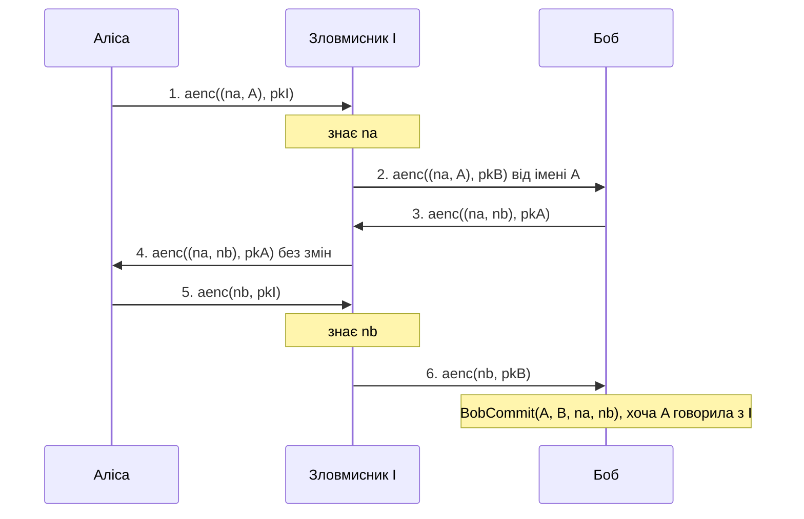

# Вимоги до звіту з практичної роботи

Ці вимоги спільні для ПР1 (ProVerif, JWT) і ПР2 (Tamarin, OAuth 2.0). Особливості кожної роботи (які запити чи леми обов'язково навести в таблиці, що здати додатково) описано в розділі «Звіт» її файлу `assignment.md`.

Головна вимога: **звіт має пояснювати атаку так, щоб її міг відтворити розробник, який не бачив ні моделі, ні інструмента.** Скопійований вивід ProVerif або Tamarin без пояснення не є аналізом.

## 1. Що здати

1. Звіт у PDF, ім'я файлу `ПР<номер роботи>_<Прізвище>_В<варіант>.pdf`, наприклад `ПР1_Петренко_В3.pdf`.
2. Архів `ПР<номер>_<Прізвище>_В<варіант>.zip` з моделями: вихідна модель варіанта, виправлена модель, модель розминки з вашим виправленням, повний текстовий вивід інструмента для кожної з них (`proverif model.pv > model.out.txt`, `tamarin-prover --prove model.spthy > model.out.txt`).
3. Обсяг основної частини: 6–12 сторінок без додатків. Шрифт 12–14 пт, код моноширинним шрифтом.

## 2. Структура звіту

Розділи обов'язкові й ідуть у цьому порядку. У дужках орієнтовний обсяг.

### 2.1. Титульна сторінка

Заклад, кафедра, дисципліна, назва роботи, варіант, виконавець (група, ПІБ), викладач, дата.

### 2.2. Мета роботи (2–3 речення)

Своїми словами: що перевіряли й навіщо.

### 2.3. Середовище (таблиця)

| Параметр | Значення |
|---|---|
| ОС | macOS 15.1 / Ubuntu 24.04 (WSL2) / … |
| ProVerif або Tamarin | точна версія з `proverif -help` або `tamarin-prover --version` |
| Maude (для Tamarin) | `maude --version` |
| Час перевірки моделі | з виводу інструмента або `time` |

### 2.4. Опис протоколу (0,5–1 с.)

Учасники, їхні знання на початку (ключі, паролі), канали між ними та яким каналам ми довіряємо. Діаграма обміну повідомленнями чесного виконання протоколу (Mermaid, draw.io або від руки, але розбірливо). Кожне повідомлення пронумероване.

### 2.5. Модель (0,5–1 с.)

- Як змодельовано криптографічні примітиви (конструктори, деструктори або рівняння, вбудовані теорії Tamarin).
- Як змодельовано канали (відкритий канал, TLS).
- Що вміє зловмисник: що він знає на початку, ким може бути (власні акаунти, власні сервіси, скомпрометовані учасники).
- Спрощення моделі порівняно з реальним протоколом (не менше трьох) і чому вони прийнятні або неприйнятні для цієї перевірки.

### 2.6. Властивості (0,5 с.)

Для кожного запиту чи леми: формулювання природною мовою, формальний запис з моделі, тип властивості (секретність; автентифікація, неін'єктивна чи ін'єктивна; досяжність).

### 2.7. Таблиця результатів

Одна таблиця для всіх перевірок: рядки = властивості, стовпці = моделі.

### 2.8. Аналіз атаки (основний розділ, 2–4 с.)

Для кожної порушеної властивості:

1. покрокова таблиця траси: номер кроку, хто кому надсилає, що саме, що зловмисник знає після кроку;
2. діаграма обміну повідомленнями атаки (з позначенням зловмисника);
3. пояснення: яка перевірка була відсутня чи хибна і чому саме вона дозволила крок, на якому зловмисник досяг мети;
4. відповідність реальній вразливості: клас вразливості, посилання на RFC, CVE або статтю, приклад реального продукту чи бібліотеки, якщо є;
5. рисунок траси з інструмента (ProVerif `-graph` або граф Tamarin) як ілюстрація до таблиці, не замість неї.

### 2.9. Причина й виправлення (1 с.)

Фрагмент моделі до і після (diff), пояснення, чому виправлення закриває саме цей крок атаки, повторна таблиця результатів для виправленої моделі.

### 2.10. Перевірка досяжності (кілька речень)

Доведення «властивість виконується» нічого не варте, якщо подія, про яку йдеться у властивості, взагалі недосяжна (наприклад, сервер через помилку моделі ніколи нічого не приймає). Наведіть результат запиту чи леми досяжності для виправленої моделі та поясніть, що він означає.

### 2.11. Обмеження моделі (0,5 с.)

Яких атак ця модель принципово не може знайти. Приклади: слабкі паролі, побічні канали, помилки реалізації, якої немає в моделі, обмежена кількість ролей.

### 2.12. Висновки (3–5 пунктів)

Що знайдено, чому так сталося, як виправлено, що з цього варто взяти в реальну розробку.

### 2.13. Додатки

Повний код виправленої моделі, повний вивід інструмента, рисунки трас.

## 3. Критерії оцінювання (100 балів)

| Розділ | Бали | Що перевіряємо |
|---|---|---|
| 2.3 Середовище, відтворюваність | 5 | точні версії; модель з архіву запускається й дає той самий результат |
| 2.4 Опис протоколу | 10 | усі учасники й повідомлення; діаграма відповідає моделі |
| 2.5 Модель і припущення | 10 | можливості зловмисника названо явно; щонайменше 3 спрощення з оцінкою |
| 2.6 Властивості | 10 | природна мова збігається з формальним записом; тип властивості вказано правильно |
| 2.7 Таблиця результатів | 10 | усі запити/леми, усі моделі, час перевірки |
| 2.8 Аналіз атаки | 25 | покрокова траса без пропусків; діаграма; пояснення причини; не переказ виводу |
| 2.8 п. 4 Відповідність реальній вразливості | 10 | правильний клас вразливості, перевірене посилання (RFC, CVE, стаття) |
| 2.9–2.10 Виправлення й досяжність | 15 | мінімальне виправлення саме цієї вади; повторна перевірка; досяжність показано |
| 2.11–2.12 Обмеження, висновки, оформлення | 5 | обмеження конкретні, а не загальні фрази |
| **Разом** | **100** | |
| Додаткове завдання | до +10 | див. `assignment.md` |

Захист: 3 запитання з переліку контрольних запитань роботи плюс одне запитання за вашою трасою («що станеться, якщо на кроці 4 …?»). Звіт без захисту не зараховується.

Знижують оцінку: вивід інструмента замість пояснення (−10 і більше), атака описана без діаграми (−5), «виправлення», яке прибирає подію з моделі й робить властивість вакуумною (розділ 2.10 оцінюється в 0), посилання, якого не існує або яке не стосується вади (−10).

## 4. Приклади оформлення

Приклади нижче зроблено на розминковій моделі (протокол Нідгема–Шредера з відкритим ключем, атака Лоу), щоб не розкривати відповіді варіантів. Ваш звіт має бути такого ж рівня деталізації.

### 4.1. Приклад таблиці результатів (розділ 2.7)

| Властивість | Тип | `nspk.pv` | `nspk_lowe.pv` (виправлена) |
|---|---|---|---|
| Q1. `BobCommit(A,B,na,nb) ==> AliceRunning(A,B,na,nb)` | автентифікація, неін'єктивна | **false**, траса знайдена | true |
| Q2. `not attacker(secretNb)` | секретність | **false**, траса знайдена | true |
| Час перевірки | | 0,02 с | 0,02 с |

### 4.2. Приклад покрокової траси (розділ 2.8)

Позначення: A (Аліса) і B (Боб) чесні, I зловмисник, зареєстрований учасник зі своєю парою ключів. Аліса сама починає сесію з I.

| Крок | Повідомлення | Що знає I після кроку |
|---|---|---|
| 1 | A → I: `aenc((na, A), pkI)` | розшифровує своїм ключем: `na` |
| 2 | I(A) → B: `aenc((na, A), pkB)` | перешифрував для B від імені A |
| 3 | B → I(A): `aenc((na, nb), pkA)` | не може розшифрувати |
| 4 | I → A: `aenc((na, nb), pkA)` | пересилає без змін |
| 5 | A → I: `aenc(nb, pkI)` | розшифровує: `nb` |
| 6 | I(A) → B: `aenc(nb, pkB)` | B завершує сесію, вважаючи, що говорив з A |

Запис I(A) означає «I видає себе за A».

### 4.3. Приклад діаграми атаки (розділ 2.8)



### 4.4. Приклад пояснення причини (розділ 2.8, п. 3–4)

> Повідомлення 2 протоколу (крок 3 траси) не містить ідентичності відправника. Аліса, отримавши `aenc((na, nb), pkA)`, перевіряє лише, що в ньому її `na`, і не може відрізнити відповідь Боба від відповіді I. Тому вона вважає, що `nb` створив I, і на кроці 5 сама шифрує `nb` для I. З цього моменту зловмисник знає `nb` і завершує сесію з Бобом від імені Аліси (крок 6). Порушено обидві властивості: Боб завершив сесію з «Алісою», яка з ним сесії не вела (Q1), а `nb`, який Боб вважає спільним секретом з Алісою, відомий зловмиснику (Q2). Це атака «людина посередині» з перенаправленням повідомлень між двома сесіями, описана Г. Лоу (Lowe G., TACAS 1996, LNCS 1055, с. 147–166, doi:10.1007/3-540-61042-1_43).

### 4.5. Приклад виправлення (розділ 2.9)

```diff
-  let (=na, nb: bitstring) = adec(m2, skA) in
+  let (=na, nb: bitstring, =peer) = adec(m2, skA) in
 ...
-  out(c, aenc((na, nb), pkPeer));
+  out(c, aenc((na, nb, B), pkPeer));
```

> Боб додає свою ідентичність у повідомлення 2 протоколу, Аліса перевіряє, що вона збігається з тим, з ким вона почала сесію. На кроці 4 атаки Аліса отримує `aenc((na, nb, B), pkA)`, хоча говорила з I, і відкидає повідомлення, тому `nb` зловмиснику не розкривається. Після виправлення обидві властивості виконуються (таблиця 4.1, останній стовпець).

### 4.6. Приклад розділу «Перевірка досяжності» (розділ 2.10)

> У виправлену модель додано запит `query na: bitstring, nb: bitstring; event(BobCommit(A, B, na, nb)).` ProVerif відповідає `not event(BobCommit(...)) is false` і наводить трасу чесного виконання. Отже, Боб справді може завершити сесію з Алісою, і доведення Q1 не є наслідком того, що подія `BobCommit` недосяжна.

### 4.7. Приклад обмежень (розділ 2.11)

> Модель не враховує: (1) обчислювальну стійкість шифрування: шифр вважається ідеальним, тому атаки на конкретну схему (наприклад, на RSA без доповнення) не знаходяться; (2) атаки на реалізацію (переповнення, помилки розбору повідомлень); (3) атаки, для яких потрібна одночасна участь кількох скомпрометованих учасників, моделюються, але лише з тими можливостями, які явно надано зловмиснику; (4) час: модель не розрізняє, чи сесія триває секунду чи місяць.

## 5. Шаблон звіту

Скопіюйте й заповніть.

```markdown
# Практична робота <N>. <назва>
Варіант <N>. Виконав(ла): <ПІБ>, група <…>. Викладач: <…>. Дата: <…>.

## 1. Мета роботи
## 2. Середовище
| Параметр | Значення |
|---|---|
## 3. Опис протоколу
<учасники, канали, довіра>
<діаграма чесного виконання>
## 4. Модель
### 4.1. Примітиви
### 4.2. Канали
### 4.3. Зловмисник
### 4.4. Спрощення
## 5. Властивості
| № | Природною мовою | Формальний запис | Тип |
|---|---|---|---|
## 6. Результати
<таблиця результатів: базова модель варіанта / виправлена>
## 7. Аналіз атаки
### 7.1. Покрокова траса
### 7.2. Діаграма атаки
### 7.3. Причина
### 7.4. Відповідність реальній вразливості
## 8. Виправлення
<diff, пояснення, повторні результати>
## 9. Перевірка досяжності
## 10. Обмеження моделі
## 11. Висновки
## Додатки
А. Код виправленої моделі. Б. Повний вивід інструмента. В. Рисунки трас.
```
